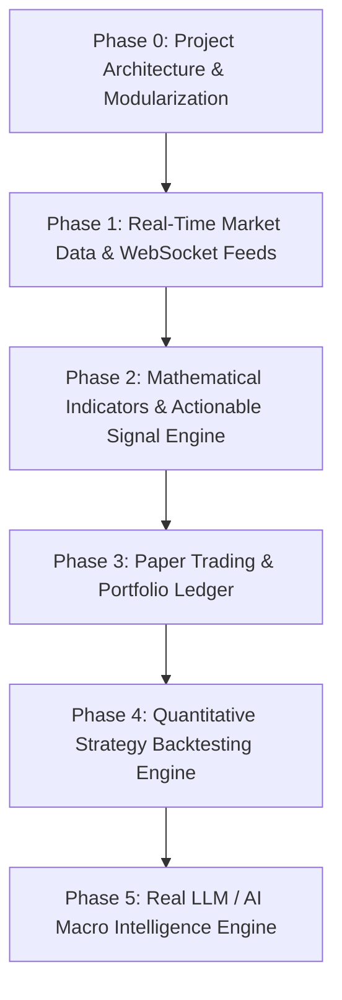

# Global Intelligence (Global.ai) — Project Architecture & Phased Roadmap

Welcome to the development roadmap for **Global Intelligence (`Global.ai`)**. This document defines the engineering transformation from the current monolithic prototype into an institutional-grade, real-time macro telemetry and paper-trading terminal.

---

## 🗺️ Architectural Phasing Overview



---

## 📌 Phase-by-Phase Breakdown

### Phase 0: Project Setup, Tooling & Modularization (Current Foundation)
- [x] Initialized Git repository with clean commit history.
- [x] Created `package.json` with zero-dependency dev server (`npm start` / `npm run dev`).
- [x] Organized backup files into `backups/` and updated `.gitignore`.
- [ ] **Decouple `index.html` (9,000+ lines) into clean modular structure:**
  - `src/core/` (state store, event bus, hash router)
  - `src/components/` (topbar, ticker, globe canvas, charts, modals)
  - `src/services/` (spatial globe service, asset data service, alert service)
  - `src/styles/` (theme variables, layout, typography)

---

### Phase 1: Real-Time Market Data & WebSocket Feeds
- [ ] Replace `Math.random()` price simulation (`tickPrices`) with real-time financial APIs:
  - Free & reliable market data integrations (Binance WebSockets for crypto, Finnhub / TwelveData / AlphaVantage / Yahoo Finance for Equities & Forex).
- [ ] Real OHLCV historical candlestick data fetching (replacing synthetic LCG generator).
- [ ] Resilient WebSocket connection manager with auto-reconnect, exponential backoff, and fallback polling.
- [ ] Connection health status indicator (`Connected`, `Reconnecting`, `Offline`) in the UI topbar.

---

### Phase 2: Mathematical Indicators & Actionable Signal Engine
- [ ] Replace hardcoded / flawed technical indicators with mathematically verified formulas:
  - **RSI (14)**: Wilder's smoothed moving average rolling calculation.
  - **MACD**: Standard 12/26 EMA line, 9 EMA signal line, and dynamic histogram bars.
  - **Bollinger Bands**: 20-period SMA $\pm 2\sigma$ standard deviation bands.
  - **ATR (14)**: True Average True Range calculation for dynamic volatility stops.
- [ ] **Actionable Trade Signal Generation Engine**:
  - Deterministic strategy algorithms (e.g., Trend-Following Golden Cross, Mean-Reversion Oversold RSI, Breakout with ATR expansion).
  - Explicit order signals: `BUY`, `SELL`, `HOLD`, `EXIT`.
  - Computed Entry Price, Dynamic Stop-Loss, and Take-Profit Targets ($\ge 2:1$ Risk-to-Reward).

---

### Phase 3: Simulated Paper-Trading & Execution Engine
- [ ] **Interactive Order Entry Modal**:
  - Order types: `Market`, `Limit`, `Stop-Loss`, `Stop-Limit`.
  - Inputs: Asset selector, Quantity, Dollar Allocation, Slippage tolerance, Time-in-Force (`GTC`, `DAY`).
- [ ] **Paper Broker Execution Simulator**:
  - Bid-ask spread crossing validation against live book data.
  - Slippage simulation and realistic simulated execution delays.
- [ ] **Dynamic Position & Cash Ledger**:
  - Real-time realized and unrealized P&L accounting.
  - Holdings table, trade history log, execution blotter.
  - Persistent browser storage (`localStorage` / `IndexedDB`) so user portfolios survive reloads.

---

### Phase 4: Quantitative Strategy Backtesting Engine
- [ ] Event-driven historical backtester running across multi-year daily/hourly OHLCV data.
- [ ] Standardized quantitative risk & performance metrics:
  - Cumulative Return & Annualized Return (CAGR)
  - Sharpe Ratio & Sortino Ratio
  - Maximum Drawdown (MDD) & Drawdown Duration
  - Win/Loss Ratio, Profit Factor, Expectancy
- [ ] Interactive equity curve visualization with trade marker overlay.
- [ ] Dynamic factor stress-testing replacing static percentages with real asset covariance matrix.

---

### Phase 5: Legitimate AI / LLM Macro Intelligence
- [ ] Connect application to live AI API (Google Gemini 2.0 / OpenAI / Anthropic):
  - Stream live macroeconomic causal thesis generation.
  - Automated financial news summarization and macro sentiment scoring.
  - Central Bank policy statement parser (Hawkish vs. Dovish scoring).
- [ ] Contextual intelligence drawer with real-time prompt-driven query interface.

---

## 🚀 How to Run the Project Locally

```bash
# 1. Start the zero-dependency dev server
npm start
# OR
npm run dev

# 2. Open in your browser
# Navigate to: http://localhost:3000
```
