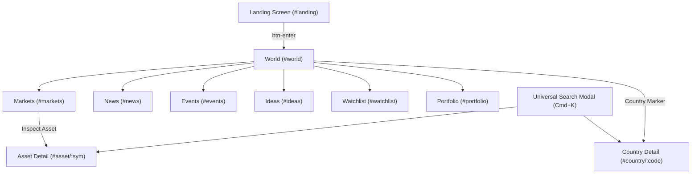
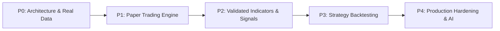

# TRADING READINESS AUDIT REPORT
**Project:** Global Intelligence (`Global.ai`)  
**Audit Date:** October 14, 2026  
**Auditor:** Automated Code Intelligence & Architectural Audit  
**Codebase State:** Monolithic Single-File Web Application (`index.html`, 9,078 lines, 492 KB)  
**Execution Context:** Standalone Client-Side Browser Application (Three.js WebGL + Vanilla JavaScript)  

---

## 1. Executive Summary & Verdict

### Overall Readiness Status: NOT TRADING READY
**Classification:** **Interactive Front-End Prototype / High-Fidelity Design Mockup**

Global Intelligence is an aesthetically polished, highly responsive institutional-style financial intelligence dashboard featuring a Three.js 3D interactive globe, multi-screen navigation, complex SVG charting with crosshairs, and a rich macro-thematic taxonomy. 

However, from an engineering and trading perspective:
1. **Zero Real Market Data:** There are **zero** network requests (`fetch`, `WebSocket`, `XMLHttpRequest`, `axios`). All asset prices, market indices, economic calendars, and news dispatches are hardcoded static JavaScript arrays. Price "streaming" is simulated locally via a pseudo-random number generator (`Math.random()`) running on a 2.2-second interval.
2. **Zero BUY/SELL/HOLD Trading Signals:** The codebase contains **no** order-generating signal logic. The words `BUY` and `SELL` do not appear anywhere in the codebase as actionable commands or signal states. The "AI Signals" shown in the UI are static strings (`BULLISH`, `CAUTION`, `HEDGE`, `NEUTRAL`) taken from a hardcoded lookup dictionary or triggered by a naive daily price change threshold (`>= +1.5%` or `<= -1.5%`).
3. **Zero Paper Trading & Backtesting:** There is **no** order entry system, no trade placement interface, no transaction log, no position sizing, and no backtesting engine. The "Simulated Portfolio" screen is a static, read-only table displaying six pre-determined holdings with hardcoded risk metrics (e.g., static Sharpe ratio of `1.82`, static Beta of `1.04`, static VaR of `2.1%`).
4. **Zero Machine Learning / External AI:** There are **no** connections to LLMs (OpenAI, Anthropic, Gemini, local models) or ML inference libraries. The "AI Core Intelligence Brain" consists of exactly six hardcoded static insight nodes and a deterministic arithmetic formula that adjusts scores based on hardcoded flags. Sub-scores (e.g., "Technical Momentum", "Fundamental Quality") are generated using ASCII character-code arithmetic on ticker symbols.
5. **Zero Backend, Database, or Server-Side Persistence:** There is no server (no Node.js, Python, or Go backend) and no database (no SQL, MongoDB, or IndexedDB). Application state is largely held in ephemeral JavaScript memory. While user preferences and mock alert configurations exist in `localStorage`, watchlist collection edits and portfolio holdings are not saved to persistent storage.
6. **No Automated Test Coverage:** There are zero unit, integration, or end-to-end tests in the repository.

---

## 2. Feature-by-Feature Verification Matrix

| Feature / Subsystem | Implementation Status | Implementation Location | Evaluation & Real-World Reality |
| :--- | :--- | :--- | :--- |
| **Hash-Based SPA Routing** | `VERIFIED WORKING` | `index.html` (`handleRoute`, L8978-9036) | Functional client-side routing supporting 9 distinct views and hash parameters (`#asset/AAPL`, `#country/IN`). |
| **Interactive 3D Earth Globe** | `VERIFIED WORKING` | `index.html` (`SpatialDataService`, L4925-5685) | Functional Three.js WebGL canvas with mouse rotation, country markers, raycasting, and camera transitions. |
| **Universal Search (Cmd+K)** | `VERIFIED WORKING` | `index.html` (`searchUniversal`, L4668-4688) | Functional in-memory tokenized search across assets, countries, news, and themes with keyboard navigation. |
| **Watchlist Multi-Collection UI** | `PARTIALLY IMPLEMENTED` | `index.html` (`renderWatchlistView`, L8178-8370) | UI allows adding/removing assets and creating collections in memory, but does **not** persist changes to `localStorage`. |
| **Live Market Data Feed** | `MOCK/DEMO` | `index.html` (`tickPrices`, L3259-3304) | **Zero APIs.** Simulated via `Math.random()` price drift every 2,200ms. |
| **Candlestick & Historical Data** | `MOCK/DEMO` | `index.html` (`AssetService.getAssetHistory`, L6097-6209) | **Zero APIs.** Candles are mathematically synthesized on-the-fly using a pseudo-random Linear Congruential Generator. |
| **BUY / SELL / HOLD Signal Logic** | `NOT IMPLEMENTED` | `index.html` (`getAssetAISignal`, L5749-5760) | No trade order signals exist. Only informational tags (`BULLISH`, `CAUTION`, `HEDGE`, `NEUTRAL`) based on a 13-item dictionary. |
| **Entry, Stop-Loss, Target Prices** | `NOT IMPLEMENTED` | None | Completely absent from all calculations and UI components. |
| **Risk-to-Reward Calculations** | `NOT IMPLEMENTED` | `index.html` (L7778) | A single hardcoded text string literal (`3.4:1 RISK-REWARD`). No formula exists. |
| **Technical Indicator: EMA (20/50/200)** | `PARTIALLY IMPLEMENTED` | `index.html` (`AssetService.getAssetHistory`, L6155-6173) | Functional exponential smoothing formula, but calculated over only 24–80 synthetic bars (insufficient convergence for EMA 200). |
| **Technical Indicator: Bollinger Bands** | `VERIFIED WORKING` | `index.html` (`AssetService.getAssetHistory`, L6174-6182) | Correct rolling 20-period standard deviation formula applied to synthetic candle closes. |
| **Technical Indicator: RSI (14)** | `PARTIALLY IMPLEMENTED` | `index.html` (`AssetService.getAssetHistory`, L6183-6197) | Flawed math: divides cumulative gains/losses across all bars $0 \dots i$ by 14 instead of a 14-bar rolling or Wilder's smoothed window. |
| **Technical Indicator: MACD** | `MOCK/DEMO` | `index.html` (`AssetService.getAssetTechnicals`, L6247-6249) | `macdLine` uses non-standard EMA20/50 ratio; `signalLine` (`0.84`) and `macdHist` (`0.42`) are hardcoded constants. |
| **Technical Indicator: ATR** | `MOCK/DEMO` | `index.html` (`AssetService.getAssetTechnicals`, L6250) | Computes single-bar high minus low (`last.high - last.low`), not an Average True Range. |
| **Paper Trading Execution Engine** | `NOT IMPLEMENTED` | None | No order form, no order types (Market/Limit/Stop), no trade placement, no transaction history, no fill simulation. |
| **Historical Strategy Backtesting** | `NOT IMPLEMENTED` | None | Completely absent. No backtest runner, no historical dataset, no performance metrics. |
| **Simulated Portfolio Tracking** | `MOCK/DEMO` | `index.html` (`renderPortfolioView`, L8629-8803) | Read-only static table with 6 hardcoded assets. Does not support adding/editing holdings or recording trades. |
| **Portfolio Risk Metrics (Sharpe, VaR)** | `MOCK/DEMO` | `index.html` (`state.portfolio.riskMetrics`, L2605-2611) | Static constants hardcoded in the data model (`sharpe: 1.82`, `beta: 1.04`, `var95: '2.1%'`). |
| **Macro Stress-Testing Engine** | `MOCK/DEMO` | `index.html` (`state.portfolio.stressScenarios`, L2612-2637) | Hardcoded static percentages (`-3.8%`, `+1.4%`, `-6.2%`) multiplied against current portfolio balance. |
| **External AI / LLM Model Integration**| `NOT IMPLEMENTED` | None | Zero LLM APIs, zero model weights, zero vector embeddings. |
| **AI Intelligence Core ("The Brain")** | `MOCK/DEMO` | `index.html` (`AIIntelligenceEngine`, L3948-4140) | Exactly 6 pre-written static insight nodes with deterministic arithmetic score adjustments. |
| **Asset AI Conviction Scorecard** | `MOCK/DEMO` | `index.html` (`renderAssetContextualAI`, L6526-6532) | Scores calculated from ASCII character codes of symbol characters (`found.sym.charCodeAt(0) * 17`). |
| **Backend & Web Server** | `NOT IMPLEMENTED` | None | No backend server exists. Entire repository consists of static HTML and backup files. |
| **Database & Schema Storage** | `NOT IMPLEMENTED` | None | No relational, document, or key-value database. |
| **Market Alert Monitoring** | `MOCK/DEMO` | `index.html` (`AlertService`, L3537-3574) | Inactive service storing 3 mock alerts. Never invoked during price updates; cannot trigger notifications. |
| **Automated Test Suite** | `NOT IMPLEMENTED` | None | Zero automated test files in the workspace. |

---

## 3. Screen-by-Screen Deep Dive & Navigation

The application uses an inline hash router (`handleRoute`, L8978-9036) listening to the browser's `hashchange` event. The layout consists of a fixed top navigation bar (`.topnav`, L1708-1738) and a mobile bottom bar (`.mobile-bottom-nav`, L2289-2298).



### Screen 1: Landing Page (`#landing`, L1696-1705)
* **Status:** `VERIFIED WORKING`
* **Features:** Fullscreen hero section with branding ("DIGITAL EARTH · GLOBAL INTELLIGENCE"), location chip ("Haryana, India"), and WebGL canvas mounting slot (`#landing-globe-slot`).
* **Implementation:** Clicking `ENTER WORLD` (`#btn-enter`, L9039) transitions to `#world` and triggers `resizeToActive()`.

### Screen 2: World Intelligence Dashboard (`#world`, L1741-1889)
* **Status:** `PARTIALLY IMPLEMENTED` (Functional UI / Mock Data)
* **Features:**
  * **Interactive WebGL Earth:** Three.js sphere with realistic landmass shaders, atmosphere glow, and country pins. Clicking pins zooms the camera and renders a country modal.
  * **Quick Watchlist Panel:** Filter pills (`All`, `Indices`, `Stocks`), SVG sparklines, and live price-tick flash animations.
  * **World Indices Widget:** Regional tabs (`Global`, `US`, `EU`, `Asia`) showing static benchmark index levels.
  * **Institutional Flows & Sentiment Gauge:** HTML5 canvas Fear & Greed dial (`drawGauge`, L3219-3253) fixed at score `68` (Greed), accompanied by static FII/DII flow statistics.
  * **World AI Command Overview & Macro Regime Monitor:** Two deterministic overview banners rendering pre-computed macro summaries.

### Screen 3: Global Markets Screener (`#markets`, L1890-1965)
* **Status:** `PARTIALLY IMPLEMENTED` (Functional UI / Mock Data)
* **Features:**
  * **Summary Metrics Grid:** Shows Advance/Decline ratio, Average Momentum, and VIX reading (`13.82`).
  * **Markets AI Regime Banner:** Breadth statistics dynamically counted from `state.masterUniverse`.
  * **Multi-Asset Screener Table:** Tab filters (`ALL`, `STOCKS`, `INDICES`, `CRYPTO`, `FOREX`, `COMMODITIES`, `BONDS`), text search, and column sorting.
  * **Heatmap Mode:** Treemap-style tile view with toggleable AI conviction overlay pills.

### Screen 4: News Intelligence Wire (`#news`, L1966-2005)
* **Status:** `PARTIALLY IMPLEMENTED` (Functional UI / Static Data)
* **Features:**
  * Displays six static mock articles with publication timestamps, source names, and impact tags (`HIGH`, `MEDIUM`, `LOW`).
  * Filter pills for category (`ALL`, `ECONOMY`, `TECH`, `MARKETS`, `GEOPOLITICS`).
  * News Dispatch Modal (`showNewsModal`, L7400-7438) displaying full text, "Why It Matters" commentary, and entity links to related assets and countries.

### Screen 5: Geopolitical & Economic Events Calendar (`#events`, L2006-2062)
* **Status:** `PARTIALLY IMPLEMENTED` (Functional UI / Static Data)
* **Features:**
  * Ten hardcoded economic events (e.g., "India Headline CPI Inflation", "Federal Reserve Chair Speech", "Bank of Japan Decision").
  * Time horizon filters (`TODAY`, `THIS WEEK`, `UPCOMING`).
  * Consensus vs. Actual surprise calculation badge (`+33.3%`, `-4.3%`).
  * Event Detail Modal (`openModal`, L7835-7878) linking directly to country benchmarks.

### Screen 6: Thematic Macro Ideas & Regimes (`#ideas`, L2063-2096)
* **Status:** `PARTIALLY IMPLEMENTED` (Functional UI / Static Data)
* **Features:**
  * Three macro theme cards ("Accelerated Computing & AI Foundry", "Global Macro Tail-Risk Hedges", "Maritime Energy Transit Risk").
  * Relative strength score bar, macro sensitivity rating, and constituent asset tags.
  * Interactive Correlation Matrix displaying pairwise correlation values between thematic baskets.

### Screen 7: Institutional Watchlist Monitor (`#watchlist`, L2097-2193)
* **Status:** `PARTIALLY IMPLEMENTED` (Functional UI / Ephemeral State)
* **Features:**
  * Multi-collection tab management (`Primary Monitor`, `Tech & AI Leaders`, `Macro & Currency Hedges`).
  * Modal actions to create new collections, rename, delete, and add assets from the master universe.
  * Watchlist Intelligence Overview cards computing real-time constituent count, advancing/declining count, and basket average drift.
  * Export to CSV button (`#wl-export-btn`, L8372-8386) downloading client-generated `.csv` data.
  * **Critical Flaw:** All mutations modify in-memory arrays only. Reloading the page discards all changes.

### Screen 8: Simulated Portfolio & Risk Analytics (`#portfolio`, L2194-2256)
* **Status:** `MOCK/DEMO`
* **Features:**
  * Static portfolio valuation card displaying `$184,250.00` total value, simulated daily P&L (`+$1,420.30`), unrealized P&L, and cash (`$18,450.00`).
  * Asset class and sector allocation bar chart with hardcoded percentages (42% Tech, 20% Semi, 14% Energy, 14% Crypto, 10% Gold/Cash).
  * Holdings table displaying six static positions (AAPL, NVDA, RELIANCE, TCS, BTC, GOLD).
  * Institutional Risk Metrics grid with static values (Sharpe `1.82`, Beta `1.04`, Volatility `14.2%`, Max Drawdown `-8.4%`, 1-Day 95% VaR `2.1%`).
  * Deterministic Stress-Testing cards simulating instantaneous factor shocks (`Global Sovereign Rate Spike +100 bps`, `Oil Shock +25%`, `Tech Compression -15%`).
  * **Critical Flaw:** Completely read-only. No button or modal exists to buy, sell, rebalance, adjust cash, or input order details.

### Screen 9: Asset Detail Intelligence Terminal (`#asset/:sym`, L2257-2270)
* **Status:** `PARTIALLY IMPLEMENTED` (Functional Chart UI / Synthetic Data)
* **Features:**
  * Header with real-time price, percentage change, day high/low, and 52-week range bar.
  * Multi-timeframe bar (`1D`, `1W`, `1M`, `3M`, `6M`, `1Y`, `5Y`, `ALL`).
  * Chart mode selector (`Candles`, `Area`, `Line`, `Volume`).
  * SVG chart engine with crosshairs, OHLC hover telemetry, and overlays for EMA 20, EMA 50, EMA 200, Bollinger Bands, RSI (14), and MACD.
  * AI Causal Thesis banner with multi-factor conviction scorecard.
  * Class-adaptive fundamentals table (Equities, Indices, Crypto, Forex, Commodities, Bonds).
  * Relative performance window vs benchmark (1D, 1W, 1M, 3M, 1Y).
  * Correlated peer assets table with direct navigation.

### Screen 10: Sovereign Intelligence Detail (`#country/:code`, L2271-2284)
* **Status:** `PARTIALLY IMPLEMENTED` (Functional UI / Static Data)
* **Features:**
  * Complete 197-country catalog lookup (Phase 5, L3306-3508).
  * Key macroeconomic indicators: Nominal GDP, CPI Inflation, Benchmark Interest Rate, Debt-to-GDP, FDI Inflows, FX Reserves.
  * Benchmark equity index tracker with a direct link to the Asset Detail Terminal.

---

## 4. Market Data Engine: Real APIs vs. Mock / Static Data

An exhaustive static code inspection verified that **zero external API calls exist in the entire codebase**.

```
Search Pattern: fetch(              --> 0 occurrences
Search Pattern: WebSocket           --> 0 occurrences
Search Pattern: XMLHttpRequest      --> 0 occurrences
Search Pattern: axios / ajax        --> 0 occurrences
External URLs:                      --> Only Google Fonts CDN and cdnjs.cloudflare.com (Three.js)
```

### Static Data Repositories
1. **Master Universe (`state.masterUniverse`, L2363-2399):** An in-memory array of exactly 28 instruments:
   * **Stocks (7):** AAPL, NVDA, MSFT, RELIANCE, TCS, TSM, ASML
   * **Indices (8):** S&P 500, NASDAQ, DOW JONES, NIFTY 50, BANKNIFTY, FTSE 100, DAX, NIKKEI 225, HANG SENG
   * **Crypto (3):** BTC, ETH, SOL
   * **Forex (4):** EUR/USD, USD/JPY, USD/INR, GBP/USD
   * **Commodities (4):** GOLD, SILVER, BRENT CRUDE, NATURAL GAS
   * **Bonds (3):** US 10Y YIELD, GERMAN 10Y BUND, INDIA 10Y G-SEC
2. **Sovereign Database (L3308-3507):** Hardcoded catalog of 197 countries with static GDP, inflation, and interest rate figures.

### Pseudo-Random Price Generator (`tickPrices`, L3259-3304)
The application simulates real-time market data using a `setInterval` timer firing every 2,200 milliseconds:

```javascript
// index.html, Lines 3259-3266
function tickPrices(){
  const universe = state.masterUniverse || state.watchlist;
  const a = universe[Math.floor(Math.random()*universe.length)];
  if(!a) return;
  const delta = (Math.random()-0.48) * (a.price*0.0009);
  a.price = Math.max(0.01, a.price + delta);
  a.chg = a.chg + delta/a.price*100*0.4;
  ...
}
setInterval(tickPrices, 2200);
```
* **Mechanism:** Randomly picks an instrument from `masterUniverse`, generates a pseudo-random delta using `(Math.random() - 0.48) * 0.09%`, updates `a.price` and `a.chg`, flashes the DOM element green or red via CSS (`flash-up`/`flash-down`), and updates matching DOM spans.
* **Assessment:** Purely visual eye-candy. No actual exchange connectivity or live pricing.

### Synthetic Candlestick Synthesis (`AssetService.getAssetHistory`, L6097-6209)
Historical candlestick charts do not load historical data. Instead, they synthesize random-walk candles on demand:

```javascript
// index.html, Lines 6110-6134
const seed = asset.sym + '_' + tf;
let r = Math.abs(hash(seed)) || 1337;
for(let i = 0; i < n; i++){
  r = (r * 9301 + 49297) % 233280; // Linear Congruential Generator
  const rnd1 = (r / 233280) - 0.485 + bias;
  ...
  const open = curPrice;
  const pctMove = rnd1 * (tf === '1D' ? 0.006 : tf === '1W' ? 0.012 : 0.022);
  const close = i === n - 1 ? basePrice : Math.max(0.0001, open * (1 + pctMove));
  ...
}
```
* **Mechanism:** An LCG seeded with the asset symbol and timeframe generates deterministic pseudo-random price bars backward from a hardcoded base timestamp (`new Date(2026, 8, 23, 14, 30)`).
* **Assessment:** The candles displayed on all charts are entirely artificial and have no relation to real historical price action.

---

## 5. Signal Generation, Indicator Logic, and Trade Parameters

### BUY / SELL / HOLD Signal Logic: NOT IMPLEMENTED
* **Zero Trading Signals:** There is no execution or signal generation pipeline producing actionable `BUY`, `SELL`, or `HOLD` recommendations.
* **Static Dictionary Lookup (`MARKET_AI_SIGNALS`, L5733-5747):** Exactly 13 assets have static, pre-written commentary and classification tags:
  ```javascript
  const MARKET_AI_SIGNALS = {
    'NVDA': { signal: 'BULLISH', score: 0.94, thesis: 'Hyperscaler capex acceleration...' },
    'TCS':  { signal: 'BULLISH', score: 0.88, thesis: 'Domestic IT balance sheet resilience...' },
    'GOLD': { signal: 'HEDGE',   score: 0.91, thesis: 'Sovereign reserve diversification...' },
    'RELIANCE': { signal: 'CAUTION', score: 0.78, thesis: 'Refining margin resistance...' },
    ...
  };
  ```
* **Crude Dynamic Fallback (`getAssetAISignal`, L5749-5760):** For instruments outside the 13 hardcoded entries, the application assigns a label based solely on whether the daily percentage change exceeds an arbitrary 1.5% threshold:
  ```javascript
  if (chg >= 1.5) return { signal: 'BULLISH', score: 0.86, ... };
  if (chg <= -1.5) return { signal: 'CAUTION', score: 0.74, ... };
  return { signal: 'NEUTRAL', score: 0.79, ... };
  ```

### Trade Parameter Calculations
* **Entry Price:** `NOT IMPLEMENTED`. Not calculated anywhere in the codebase.
* **Stop-Loss Price:** `NOT IMPLEMENTED`. Not calculated anywhere in the codebase.
* **Target Price:** `NOT IMPLEMENTED`. Not calculated anywhere in the codebase.
* **Risk-to-Reward Ratio:** `NOT IMPLEMENTED`. Appeared once as a hardcoded text label (`3.4:1 RISK-REWARD`, L7778) in an HTML template; no calculation exists.

### Technical Indicator Implementations
The indicators in `AssetService.getAssetHistory` (L6155-6197) and `AssetService.getAssetTechnicals` (L6211-6253) were audited:

1. **Exponential Moving Averages (EMA 20, EMA 50, EMA 200):**
   * *Formula:* $e_t = c_t \times k + e_{t-1} \times (1 - k)$ where $k = \frac{2}{N+1}$.
   * *Evaluation:* Mathematical implementation of exponential smoothing is correct. However, it is executed over synthetic candle buffers of only 24 bars (`1D`), 30 bars (`1M`), or 80 bars (`ALL`). Because an EMA 200 requires hundreds of bars to burn in and converge, computing it over 24–80 bars results in severe numerical distortion.
2. **Bollinger Bands (20, 2):**
   * *Formula:* Upper/Lower = $\mu_{20} \pm 2 \times \sigma_{20}$.
   * *Evaluation:* Correctly computes sample mean and standard deviation over a sliding 20-bar window on synthetic data.
3. **Relative Strength Index (RSI 14):**
   * *Formula in Code:*
     ```javascript
     if(i < 14){
       rsiVals.push(50 + (asset.chg || 0) * 1.5);
     } else {
       const avgGain = (gains / 14);
       const avgLoss = (losses / 14) || 0.0001;
       const rs = avgGain / avgLoss;
       const rsi = 100 - (100 / (1 + rs));
       rsiVals.push(Math.max(10, Math.min(90, rsi)));
     }
     ```
   * *Evaluation:* **Flawed implementation.** `gains` and `losses` are accumulated across all bars from $1 \dots i$ without clearing or rolling. Dividing cumulative sums from 60 or 80 bars by 14 artificially inflates both averages and invalidates the RS ratio.
4. **Moving Average Convergence Divergence (MACD):**
   * *Implementation:*
     ```javascript
     macdLine: ((lastEma20 - lastEma50) / (last.close || 1) * 100),
     signalLine: 0.84,
     macdHist: 0.42,
     ```
   * *Evaluation:* **Mock / Hardcoded.** Standard MACD uses $(EMA_{12} - EMA_{26})$ and a 9-period EMA signal line. Here, `macdLine` uses a normalized EMA20/50 difference, while `signalLine` is permanently hardcoded to `0.84` and `macdHist` is permanently hardcoded to `0.42`.
5. **Average True Range (ATR):**
   * *Implementation:* `atr: (last.high - last.low)`
   * *Evaluation:* **Mock.** This is simply the high-low range of the most recent candle. It does not factor in previous close gaps or a 14-period rolling average.

### Model Conviction & Factor Scoring
* **AI Confidence Engine (`AIConfidenceEngine.calculate`, L3764-3794):** Evaluates a simple deterministic formula:
  $$\text{Score} = \text{base (0.50)} + 0.05 \times \text{evidenceCount} \pm 0.10 \text{ (tech)} \pm 0.075 \text{ (macro)} + 0.025 \times \text{corrCount} - \text{penalty}$$
  The resulting score is clamped to the range $[0.15, 0.96]$.
* **Asset Conviction Scorecard (`renderAssetContextualAI`, L6526-6532):** The multi-factor scores displayed in the Asset Detail view (Technical Momentum, Fundamental Quality, Macro Tailwind, Downside Fragility) are produced by hashing the ASCII character codes of the symbol string:
  ```javascript
  const seed = (found.sym.charCodeAt(0) * 17 + (found.sym.charCodeAt(1) || 65) * 11) % 25;
  const techScore = Math.min(96, Math.max(68, 80 + (found.chg >= 0 ? 8 : -8) + (seed % 9)));
  const fundScore = Math.min(98, Math.max(70, 84 + (seed % 12)));
  const macroScore = Math.min(95, Math.max(65, 78 + (found.cat === 'crypto' || found.cat === 'stocks' ? 6 : 2)));
  const fragilityScore = Math.max(12, Math.min(48, 25 - (found.chg >= 0 ? 5 : -10) + (seed % 8)));
  ```

---

## 6. Backtesting and Paper Trading Assessment

### Historical Backtesting: NOT IMPLEMENTED
* **Zero Backtest Capabilities:** There are no strategy definition schemas, no event loops, no historical tick or bar loaders, and no backtesting engines.
* **Absence of Performance Metrics:** Metrics standard to quantitative trading—such as Compound Annual Growth Rate (CAGR), Maximum Drawdown duration, Win/Loss Ratio, Profit Factor, Sortino Ratio, and Calmar Ratio—are completely absent from the codebase.

### Paper Trading Engine: NOT IMPLEMENTED
While the application provides a "Simulated Portfolio" screen (`route-portfolio`, L8629-8803), it lacks the functional requirements of paper trading:


1. **No Order Entry Interface:** There are no buy or sell buttons, order tickets, or input fields for order quantity, limit price, stop price, or time-in-force.
2. **No Position Management:** The six holdings in `state.portfolio.holdings` (AAPL, NVDA, RELIANCE, TCS, BTC, GOLD) cannot be modified, closed, or expanded.
3. **No Trade History or Blotter:** There is no execution log, transaction ledger, or order blotter tracking fills, commissions, or slippage.
4. **Hardcoded Risk Metrics:** The institutional risk statistics (`state.portfolio.riskMetrics`) are static strings:
   * Sharpe Ratio: `1.82` (hardcoded)
   * Beta: `1.04` (hardcoded)
   * Realized Volatility: `14.2%` (hardcoded)
   * Max Drawdown: `-8.4%` (hardcoded)
   * 1-Day 95% VaR: `2.1%` (hardcoded)
5. **Static Stress Scenarios:** The factor shocks (Rate Spike, Energy Shock, Tech Compression) do not calculate real portfolio covariance; they apply static multiplier percentages (`-3.8%`, `+1.4%`, `-6.2%`) directly to the portfolio balance.

---

## 7. AI & Machine Learning Architecture Audit

### External AI Model Connectivity: NOT IMPLEMENTED
* There are **no API integrations** with external model providers:
  * OpenAI API (`api.openai.com`): `0 occurrences`
  * Anthropic API (`api.anthropic.com`): `0 occurrences`
  * Google Gemini API (`generativelanguage.googleapis.com`): `0 occurrences`
  * Local LLM / Ollama (`localhost:11434`): `0 occurrences`
  * HuggingFace / ONNX Runtime Web / TensorFlow.js: `0 occurrences`

### Rule-Based Deterministic Implementation ("The Brain", Phase 6A)
The features branded as "AI Core Intelligence", "The Brain", and "AI Causal Theses" are implemented entirely with deterministic JavaScript rules:
1. **Static Pre-Authored Insight Catalog (`rawNodes`, L3953-4140):** Contains exactly six pre-written insight records:
   * `ai-node-tcs-support`: "Technical support level confirmation with positive sector sentiment"
   * `ai-node-reliance-caution`: "Profit booking observed after recent refinery margin rally"
   * `ai-node-it-sector-opp`: "Global enterprise demand recovery signals building across cloud services"
   * `ai-node-nvda-capex-momentum`: "Hyperscaler hardware spend multi-quarter visibility expansion"
   * `ai-node-global-macro-easing`: "Synchronized monetary policy easing cycle transmission"
   * `ai-node-eurozone-composite-caution`: "Eurozone composite economic activity divergence"
2. **Fixed Causal Narrative Strings:** Clicking on "Audit Model Architecture" displays pre-authored static paragraphs (e.g., *"Sustained capital expenditure allocations, multi-quarter order-book visibility..."*).
3. **Promotional Terminology vs Code Reality:**
   * Marketing Label: *"100% DETERMINISTIC MODEL"* $\rightarrow$ Reality: Hardcoded static text nodes.
   * Marketing Label: *"AI CORE INTELLIGENCE ARCHITECTURE"* $\rightarrow$ Reality: Standard object validation schema (`validateAIInsight`, L3711) and string hash deduplication (`AIDeduplicator`, L3814).
   * Marketing Label: *"SPATIAL AI OVERLAY"* $\rightarrow$ Reality: SVG pulse animations positioned at fixed geographical coordinates on the Three.js globe.

---

## 8. Backend, Database, Security, and Alert Subsystems

### Backend & Server Architecture: NOT IMPLEMENTED
* The project has **no server-side tier**. It runs entirely inside the user's web browser as an uncompiled static HTML file.
* There are no deployment artifacts, Dockerfiles, or API route definitions.

### Database & Storage: NOT IMPLEMENTED
* There is no server database (PostgreSQL, SQLite, MongoDB) and no client-side database (IndexedDB).
* Application state is stored in an ephemeral global JavaScript variable (`window.state`, L2362).

### API Key Security & Secret Management: NOT APPLICABLE
* There are no API keys, tokens, or environment credentials present in the codebase.
* Because no external APIs are called, there is no immediate risk of credential exposure, but no secret management architecture exists for future integration.

### Persistence Engine: MINIMAL / INCOMPLETE
Inspection of all `localStorage` calls across the project revealed exactly three storage keys:
1. `gi_user_preferences` (L3524, L3531): Stores UI preferences (base currency, default market, globe theme, visible table columns).
2. `gi_alerts` (L3541, L3553): Stores user-defined mock alert rules.
3. `gi_recent_searches` (L4418, L4435): Stores recently typed queries in Universal Search.

**Critical Persistence Flaw:** Watchlist collections created or modified via the UI, custom-added assets, and portfolio holdings are **never saved to `localStorage`**. A single browser page refresh resets all state back to initial hardcoded defaults.

### Market Alert Engine: MOCK / INOPERATIVE
* **Service Definition (`AlertService`, L3537-3574):** Defines an interface to add, toggle, and delete alert rules (e.g., `NVDA >= 450.00`, `BTC vol_above 25.0`).
* **Critical Operational Defect:** `AlertService` is completely disconnected from the price update loop. The `tickPrices` function (L3259) never calls `AlertService.getAlerts()` or evaluates active price conditions.
* **Notification Dropdown (`dd-notif`, L4897-4909):** The notification bell icon opens a static dropdown with hardcoded mockup text ("Oil supply disruption detected", "NIFTY unusual volume detected"). It is not linked to active alerts or real market events.

---

## 9. Quality Assurance, Test Suite, and Runtime Reliability

### Automated Test Suite: NOT IMPLEMENTED
* **Zero Tests:** There are no test files (`*.test.js`, `*.spec.js`), no test runners (Jest, Vitest, Playwright), and no assertion libraries.
* **Syntax Validation:** An offline syntax check using Node.js (`node --check`) confirmed that the 6,733 lines of inline JavaScript parse cleanly with no syntax errors.

### Runtime Environment & Vulnerabilities
1. **Single-Point-of-Failure CDN Dependency:**
   * Three.js is loaded via an external CDN script tag:
     `<script src="https://cdnjs.cloudflare.com/ajax/libs/three.js/r128/three.min.js"></script>`
   * If the user runs the application offline, or if the CDN is unreachable, the 3D globe crashes, blocking execution of subsequent initialization scripts.
2. **WebGL Context Failure in Headless / Restricted Browsers:**
   * If initialized on systems without WebGL hardware acceleration or inside headless test browsers, Three.js context initialization may fail silently or throw errors.
3. **Hardcoded Date Anchors:**
   * The synthetic candle generator hardcodes a base date: `new Date(2026, 8, 23, 14, 30)` (September 23, 2026). Timestamps throughout the app are anchored to fixed epochs (e.g., `1711000000000` = March 21, 2024), leading to conflicting dates across different widgets.

### Discrepancies and Unverified Claims
* **"LIVE" Badge vs. Random Number Generator:** The top bar and ticker track display glowing `<span class="dot-live"></span> LIVE` chips, implying an institutional data feed. In reality, prices are simulated by `(Math.random() - 0.48) * price * 0.0009`.
* **"AI Signal Conviction" vs. ASCII Hashing:** The UI presents metrics such as "94% MODEL CONVICTION" and "AI FACTOR CONVICTION SCORECARD". In code, these are static dictionary properties or arithmetic transformations of ticker character codes.
* **"Deterministic AI Stress-Testing":** Promoted as macro factor shock simulation, but performs simple scalar arithmetic against hardcoded percentage deltas without calculating portfolio asset covariance or beta sensitivity.

---

## 10. Prioritized Roadmap to Achieve Paper-Trading Readiness

To transform Global Intelligence from a visual front-end prototype into an actual, reliable paper-trading platform, the following phased engineering roadmap is required:



### Phase P0: Core Architecture & Real Market Data (Foundational Blocker)
1. **Decouple Front-End from Monolithic File:**
   * Split `index.html` into a structured modern project (e.g., Vite/TypeScript or Next.js) separating UI components, state management, chart renderers, and market data services.
2. **Integrate Real-Time Market Data APIs:**
   * Connect to legitimate financial market data providers via WebSockets and REST (e.g., Polygon.io, Alpaca Markets, Interactive Brokers, Binance WebSocket, or TwelveData).
   * Replace `tickPrices()` with a real pub/sub market data stream handler.
3. **Real Historical Candlestick Retrieval:**
   * Replace synthetic LCG candle generation with real OHLCV historical data fetched from exchange endpoints.

### Phase P1: Core Paper-Trading Engine & Execution Simulation (Critical Blocker)
4. **Order Entry System:**
   * Build an Order Placement Modal supporting order types: `Market`, `Limit`, `Stop-Loss`, `Stop-Limit`.
   * Add input fields for quantity, dollar amount, limit price, and Time-in-Force (`GTC`, `DAY`).
5. **Simulated Broker & Fill Engine:**
   * Implement a paper-trading execution simulator that validates orders against live bid/ask spreads.
   * Model realistic market execution factors: bid-ask spread crossing, volume availability, slippage, and trading commissions.
6. **Dynamic Position & Cash Ledger:**
   * Build a real-time portfolio management service calculating real average entry price, realized P&L, unrealized P&L, portfolio cash, and equity balance.
   * Persist portfolio state, open positions, order history, and fill blotters to a persistent database (PostgreSQL / SQLite / IndexedDB).

### Phase P2: Validated Technical Indicators & Signal Generation
7. **Refactor Technical Indicator Library:**
   * Replace existing indicator logic with a mathematically verified technical analysis library (such as `tulipindicators` or `technicalindicators`).
   * Fix RSI (14) rolling window calculation and replace hardcoded MACD signal line / histogram constants with standard 12/26/9 EMA calculations.
   * Calculate true 14-period Average True Range (ATR).
8. **Automated Trade Signal Generation:**
   * Implement verifiable signal generation strategies (e.g., EMA 20/50 Golden Cross, RSI Oversold Reversal with Volume Confirmation, Bollinger Band Mean Reversion).
   * Programmatically generate entry price, stop-loss level (e.g., $1.5 \times ATR$), take-profit targets, and risk-reward ratios ($\ge 2:1$).

### Phase P3: Historical Strategy Backtesting Engine
9. **Backtesting Simulation Framework:**
   * Develop an event-driven backtesting engine capable of executing historical simulations across multi-year OHLCV bar datasets.
   * Generate standardized quantitative performance reports: CAGR, Sharpe Ratio, Sortino Ratio, Maximum Drawdown, Win Rate, Profit Factor, and equity curve visualizations.
10. **Dynamic Factor Stress-Testing:**
    * Replace hardcoded scenario percentages with a true covariance matrix calculating historical portfolio factor betas against interest rates, crude oil shocks, and equity drawdowns.

### Phase P4: Alert Subsystem, Tests, and Legitimate AI Integration
11. **Functional Market Alert Engine:**
    * Connect `AlertService` to the active market data stream.
    * Trigger browser notifications (Web Notifications API) and audio alerts when price, volume, or indicator thresholds are breached.
12. **Automated Testing Suite:**
    * Implement unit tests (Vitest/Jest) for indicator math, order fill simulation, and P&L calculations.
    * Implement end-to-end tests (Playwright) covering order entry, portfolio updates, and navigation.
13. **Legitimate AI / LLM Implementation:**
    * Connect to an external LLM via a secure backend proxy to generate dynamic macro theses based on real news feeds, financial statements, and calendar prints rather than hardcoded mock nodes.

---
*Report certified and saved to `TRADING_READINESS_AUDIT.md`.*
