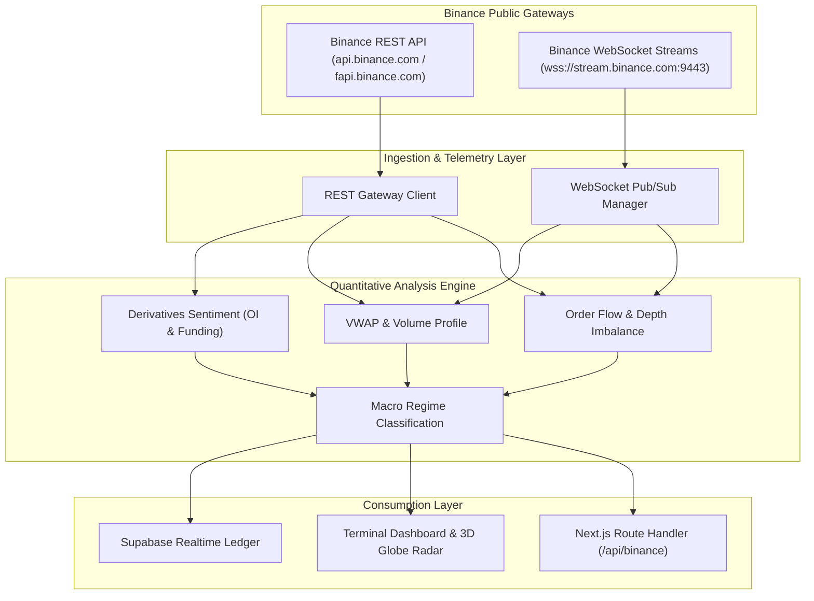

# Binance Real-Time Market Analysis Architecture & API Documentation

**Project:** Global Intelligence Terminal (`Global.ai`)  
**Standard:** Institutional Real-Time Telemetry & Quantitative Market Analysis  
**Data Sources:** Binance Spot & USDⓈ-M Futures Public Market APIs  

---

## 1. Architecture Overview

To replace synthetic simulation models with verifiable, institutional-grade market data, Global Intelligence integrates Binance's public REST and WebSocket telemetry streams.

---

## 2. API Endpoints & Data Specifications

### 2.1 Spot Market Telemetry (REST & WebSockets)

| Stream / Endpoint | Type | Endpoint / Stream Name | Latency / Frequency | Key Fields |
| :--- | :--- | :--- | :--- | :--- |
| **24hr Ticker Statistics** | REST | `GET /api/v3/ticker/24hr?symbol={SYMBOL}` | Request-based | `lastPrice`, `priceChangePercent`, `volume`, `quoteVolume`, `highPrice`, `lowPrice` |
| **Mini-Ticker Stream** | WebSocket | `<symbol>@miniTicker` | 1000ms push | `s` (symbol), `c` (close), `h` (high), `l` (low), `v` (volume), `q` (quote volume) |
| **Aggregate Trades** | WebSocket | `<symbol>@aggTrade` | Real-time (tick) | `p` (price), `q` (quantity), `m` (is buyer market maker), `T` (timestamp) |
| **Order Book Depth L20** | WebSocket | `<symbol>@depth20@100ms` | 100ms push | `bids` `[[price, qty], ...]`, `asks` `[[price, qty], ...]` |
| **OHLCV Candlesticks** | REST / WS | `GET /api/v3/klines` / `<symbol>@kline_{interval}` | 1m, 5m, 1h, 1d | Open, High, Low, Close, Volume, Taker buy base asset volume |

### 2.2 USDⓈ-M Futures & Derivatives Sentiment

Derivatives data provides essential institutional insight into market positioning, leverage, and liquidation hazards:

| Metric | Type | Endpoint | Key Insights |
| :--- | :--- | :--- | :--- |
| **Open Interest (OI)** | REST | `GET /fapi/v1/openInterest?symbol={SYMBOL}` | Measures capital committed to the market. Rising price + rising OI = strong conviction. |
| **Funding Rate** | REST | `GET /fapi/v1/fundingRate?symbol={SYMBOL}&limit=10` | Measures perpetual premium/discount vs spot. Extreme positive rate (>0.03%) = overleveraged longs. |
| **Top Trader Long/Short Ratio** | REST | `GET /futures/data/topLongShortPositionRatio?symbol={SYMBOL}&period=5m` | Position exposure of elite accounts (top 20% balance). |
| **Taker Buy/Sell Volume Ratio** | REST | `GET /futures/data/takerlongshortRatio?symbol={SYMBOL}&period=5m` | Aggressive market buy vs market sell volume ratio (pure market orders). |

---

## 3. Quantitative Market Analysis Models

### 3.1 Order Flow Imbalance (OFI) & Depth Skew
Calculates the relative buying vs selling pressure across the top 20 levels of the order book:

$$\text{Depth Skew} = \frac{\sum_{i=1}^{20} \text{BidQty}_i - \sum_{i=1}^{20} \text{AskQty}_i}{\sum_{i=1}^{20} \text{BidQty}_i + \sum_{i=1}^{20} \text{AskQty}_i}$$

- $\text{Skew} > +0.25$: Strong Bid Wall (Absorption / Bullish Cushion)
- $\text{Skew} < -0.25$: Strong Ask Wall (Supply Overhead / Bearish Pressure)
- $-0.25 \le \text{Skew} \le +0.25$: Symmetric Liquidity / Balanced Market

### 3.2 Volume Weighted Average Price (VWAP)
Calculated continuously over the trailing 24-hour window:

$$\text{VWAP} = \frac{\sum (P_i \times Q_i)}{\sum Q_i}$$

- **Current Price > VWAP**: Buyers in control; institutional trend support.
- **Current Price < VWAP**: Sellers in control; distribution regime.

### 3.3 Derivatives Positioning Matrix

| Funding Rate | Open Interest Delta | Price Direction | Institutional Interpretation | Signal Bias |
| :--- | :--- | :--- | :--- | :--- |
| **Positive (> +0.01%)** | Increasing ($\uparrow$) | Rising ($\uparrow$) | Aggressive Long Expansion | `BULLISH_EXPANSION` |
| **Extremely High (> +0.05%)**| Divergent ($\downarrow$) | Stalling / Reversing | Long Crowding / Long Squeeze Hazard | `CAUTION_LONG_EXHAUSTION` |
| **Negative (< -0.01%)** | Increasing ($\uparrow$) | Falling ($\downarrow$) | Aggressive Short Building | `BEARISH_EXPANSION` |
| **Extremely Negative** | Elevated ($\uparrow$) | Flat / Support Bounce | Short Crowding / Short Squeeze Squeeze | `HIGH_CONVICTION_SHORT_SQUEEZE` |

---

## 4. Connection Resilience & Rate Limiting

1. **IP Weight Limits:**
   - Binance Spot enforces an IP limit of 1,200 weight units per minute.
   - Endpoint weights:
     - `/api/v3/ticker/24hr`: Weight 1 (single symbol) or 40 (all symbols)
     - `/api/v3/klines`: Weight 2
     - `/api/v3/depth`: Weight 2 (limit 20) or 5 (limit 100)
   - Cache responses using an in-memory TTL of 1.5–3 seconds to preserve IP quota.

2. **WebSocket Keep-Alive & Auto-Reconnect:**
   - WebSocket connections are severed by Binance every 24 hours.
   - Client implements exponential backoff reconnection (`initial: 1000ms`, `factor: 1.5`, `max: 30000ms`).
   - Ping/pong heartbeat monitoring keeps connection alive through cloud proxies.

---

## 5. Implementation Files

- **Quantitative Engine & Client**: [`utils/binance/marketAnalysis.ts`](../utils/binance/marketAnalysis.ts)
- **Next.js API Telemetry Route**: [`app/api/binance/route.ts`](../app/api/binance/route.ts)
- **Live Terminal Telemetry Screen**: [`app/market-analysis/page.tsx`](../app/market-analysis/page.tsx)
